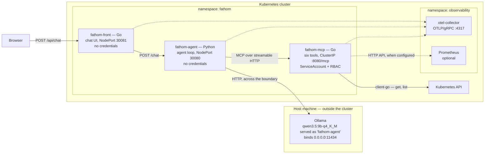
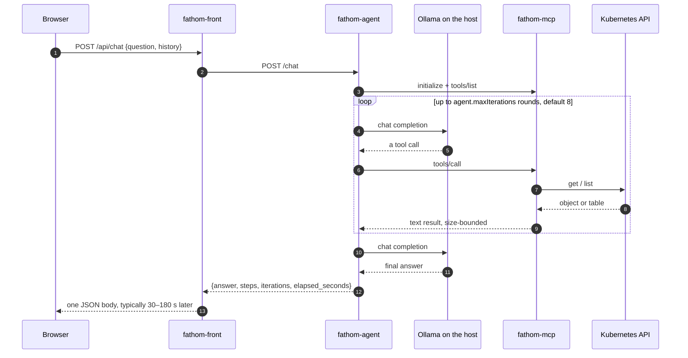

# Fathom

Fathom answers questions about a Kubernetes cluster by pointing a locally-hosted language
model at a set of read-only tools. You ask "which pods are not running, and why?" in a
browser; a model running on your own hardware decides which cluster reads would answer
that, makes them, and writes the answer back.

It is three services inside the cluster plus a model server outside it. The split is the
design, not an accident of packaging: **the agent that drives the model holds no
Kubernetes credentials at all.** It runs with `automountServiceAccountToken: false` and no
RBAC, so every cluster read goes through `fathom-mcp`, which owns the only service account
that can read anything. Widening what the model can see is a Helm values change in one
chart — never a code change in the agent.

Status: Phase 1, complete. All four deliverables build and deploy, currently at **v0.5.1**
across all three charts.

---

## Architecture

### Topology



### One turn



A turn **blocks**. The agent does not stream — it runs the whole tool-calling loop and
then returns a single JSON body. Every timeout in the system is sized around that, and the
UI counts the seconds out loud so the wait does not read as a hang.

### Three consequences worth understanding

- **The model is across a network boundary.** The agent is a pod; Ollama listens on the
  host. `localhost` means the pod, and a Service cannot reach outside the cluster, so the
  agent dials the host's address on the node network directly — `192.168.56.1:11434` in
  this lab. That endpoint is configuration in two files that must agree:
  `ollama/config.env` and `agent/helm/values.yaml`. Never a hardcoded default that happens
  to work on one machine.

- **The read-only boundary lives in exactly one place.** `mcp/helm/values.yaml`'s
  `k8s.allowedResources` is simultaneously the tool allowlist *and* the source of the
  RBAC rules rendered by `mcp/helm/templates/rbac.yaml`. That coupling is what keeps the
  two in lockstep. The verbs are hardcoded to `get` and `list` (plus `get` on `pods/log`)
  and are deliberately not parameterised — widening past read verbs takes a template edit
  and an explicit decision, not a `--set`.

- **The Prometheus tools are gated, not merely optional.** With `prometheus.url` empty
  there is no Prometheus client and those three tools are absent from `tools/list`
  entirely. A tool that fails on every call is worse than one that is not there: the model
  spends a turn discovering it, and reads the failure as a cluster problem rather than a
  deployment choice.

### The components

|  | `fathom-mcp` | `fathom-agent` | `fathom-front` |
|---|---|---|---|
| Language | Go 1.26 | Python 3.12 | Go 1.26 |
| Owns | the six tools, and the only cluster-reading ServiceAccount | the agent loop and `POST /chat` | the chat UI and the `/api/chat` proxy |
| Built on | MCP Go SDK, client-go | FastAPI, LangGraph | stdlib `net/http` — no framework |
| K8s credentials | **yes** — ClusterRole, `get`/`list` | none | none |
| Conversation state | none | none — `/chat` is stateless | none — the transcript lives in the browser |
| Reached at | `fathom-mcp.fathom.svc.cluster.local:8080/mcp` | NodePort `30080` | NodePort `30081` |

### The six tools

All read-only, in two groups with different backends.

**Kubernetes** — backed by client-go, always registered, scoped by the ClusterRole:

- `k8s_get` — one object as YAML, or a kubectl-style table for a list
- `k8s_describe` — kubectl's own describer output, events included by default
- `k8s_log` — container logs, tail-bounded and byte-capped before they reach the model

**Prometheus** — backed by the Prometheus HTTP API, registered only when `prometheus.url`
is set. No Kubernetes credentials are involved and no RBAC attaches to them:

- `list_metrics` — metric names, filterable by substring or selector
- `describe_metric` — type, help text, series count, and label values
- `run_promql` — **instant queries only**. `rate(x[5m])` works inside one query, but there
  is no `query_range`, so nothing returns a series to plot.

The read-only property holds on the Prometheus side by construction: the four endpoints
used (`/api/v1/query`, `/api/v1/series`, `/api/v1/metadata`,
`/api/v1/label/__name__/values`) only read the TSDB.

---

## Requirements, assumptions and dependencies

### What must already exist

None of the following is provisioned by this repository. Fathom assumes it and fails
loudly when it is missing.

- **A running Kubernetes cluster.** This lab is three libvirt/Vagrant VMs on
  `192.168.56.0/24`, reachable from the workstation. The cluster is built **outside this
  repo** — there is no Terraform, Ansible, or Vagrantfile here.

- **The host reachable from inside the cluster.** Pods must be able to open
  `192.168.56.1:11434`. That address is the host's IP *on the node network* — not
  libvirt's default `virbr0` at `192.168.122.1`, which the nodes are not on. Both
  addresses answer from the workstation, which is exactly what makes the wrong one easy to
  pick. Confirm both sides:

  ```sh
  kubectl get nodes -o wide     # the nodes' INTERNAL-IP
  ip -brief addr show           # the host's address on that same subnet
  ```

- **An image registry the nodes can pull from** — `registry.lab:5000`, plain HTTP, so
  Docker and containerd both need it listed as insecure. If that is more trouble than it
  is worth, `mcp/README.md` documents side-loading images with
  `ctr -n k8s.io images import` instead.

- **An OTLP collector** at `otel-collector.observability.svc.cluster.local:4317`, accepting
  gRPC in plaintext. If you do not have one, set `otel.mode=off` (or `console`) in all
  three charts — the services degrade to no-op providers with a warning rather than
  failing to start, but leaving the default pointed at nothing means every export attempt
  is a wasted retry.

- **Prometheus, optionally**, at `prometheus-server.observability.svc.cluster.local:80` —
  note port 80, not 9090, which is what that Service actually listens on. Without it,
  Fathom runs with three tools instead of six and nothing else changes.

- **A CoreDNS that cannot resolve `.lab` names.** This is a property of the lab, not a
  requirement, but it explains a decision that otherwise looks strange: the agent dials
  Ollama by IP, and the ExternalName Service the chart ships is off by default
  (`ollama.service.create: false`). See
  [Why not the ExternalName Service](agent/README.md#why-not-the-externalname-service) for
  the full post-mortem.

### Host requirements, for the model

From `ollama/config.env`, which is the single source of truth for all of it:

- **Ollama**, installed and managed by systemd. `ollama/setup.sh` writes a drop-in unit and
  restarts the service; it will not work without one.
- **`qwen3.5:9b-q4_K_M`** — roughly 6.6 GB on disk, and about 8 GB of free VRAM or RAM to
  serve at `num_ctx=16384`. The KV cache grows linearly with the context length, so
  raising `FATHOM_NUM_CTX` costs memory in proportion.
- **Network exposure.** Ollama must bind beyond loopback for pods to reach it, and
  **Ollama has no authentication** — anything that can open port 11434 can run inference
  and enumerate models. `FATHOM_FIREWALL=1` makes `setup.sh` add a rule restricting the
  port to `FATHOM_ALLOWED_CIDR`. It is off by default so the script does not silently
  reconfigure a firewall you may be managing elsewhere.

### Build toolchain

| Tool | Version | Needed for | Without it |
|---|---|---|---|
| Go | 1.26+ | `mcp`, `front` | cannot build either |
| Python | 3.12+ | `agent` | cannot build the agent |
| Docker | any | building images, and `make lock` in `agent/` | no images; `make lock` fails |
| kubectl | matching the cluster | deploying, and the rollout gates in `make deploy` | cannot deploy |
| helm | 3.x | install and upgrade, chart lint | `lint-chart` **skips, cleanly** |
| node | any | the `front` UI tests | `test-ui` **skips, cleanly** |
| git | any | version derivation via `git describe` | versions fall back to `dev` |

The two "skips cleanly" rows are deliberate and worth knowing about: `make check` passes
on a machine with no helm and no node, having silently not run the chart lint or the UI
tests. Both print a line saying so.

### Application dependencies

The manifests are authoritative — `agent/pyproject.toml` with `agent/requirements.lock`,
`mcp/go.mod`, and `front/go.mod`. What is worth knowing without reading them:

- **`agent`** — FastAPI and uvicorn, LangGraph 1.2.11 with langchain-core, plus
  `langchain-ollama` and `langchain-mcp-adapters`. The tool schemas are never restated
  locally; they come from the MCP server's `tools/list`, so adding a tool in Go needs no
  Python change. OTel SDK 1.44.0.
- **`mcp`** — the MCP Go SDK v1.7.0 and client-go v0.36.3, plus `k8s.io/kubectl` for the
  describer, so `k8s_describe` returns the same text `kubectl describe` does. OTel SDK
  1.45.0.
- **`front`** — OTel and nothing else. No web framework, no npm, no package.json,
  no build step; the UI is plain HTML/CSS/JS embedded into the binary with `go:embed`, and
  its tests run under bare `node` using only builtins.

### Python dependency changes are a two-step

`agent/Dockerfile` installs `requirements.lock` and then runs `pip install --no-deps .`,
which makes the lock the **only** source of what lands in the image. Editing
`pyproject.toml` without re-locking produces an image that builds green and then dies on
`ImportError` at pod start.

```sh
make -C agent lock     # needs Docker; regenerates requirements.lock
```

`make check` guards this with a `lock-check` target that compares mtimes and fails if the
lock is older than `pyproject.toml`.

---

## Layout

Each component is a top-level directory with its own chart and its own release lifecycle.

```
agent/          Python agent — src/fathom_agent/, tests/, Dockerfile, helm/
mcp/            Go MCP server — cmd/, internal/, Dockerfile, helm/
front/   Go chat UI — cmd/, internal/ (assets embedded), Dockerfile, helm/
ollama/         host-side setup — config.env (every knob) + setup.sh (applies them)
Makefile        cuts one version across all three components at once
```

Two structural facts that catch people out:

- **There is no top-level `helm/`.** The charts are `agent/helm`, `mcp/helm` and
  `front/helm`.
- **`mcp/helm` creates the `fathom` namespace and the other two do not**
  (`namespace.create: false`). Two Helm releases both owning one Namespace object collide
  on install.

---

## Build and run

### Cold start, in order

**1. Set up the model on the host.**

```sh
sudo ollama/setup.sh          # systemd drop-in, model pull, derived alias
ollama/setup.sh --verify      # check an existing install, change nothing
```

This creates the `fathom-agent` alias from the base model with `num_ctx`, `temperature`
and `top_p` pinned into its Modelfile, then prints the `ollama.url` and `ollama.model`
values to copy into `agent/helm/values.yaml`.

**2. Run the gates.**

```sh
make check                    # every component's fmt, lint, tests, chart lint
```

**3. Build and push the images.**

```sh
make -C mcp push VERSION=0.5.1
make -C agent push VERSION=0.5.1
make -C front push VERSION=0.5.1
```

**4. Install, in order — mcp, then agent, then front.** The order is load-bearing, not
cosmetic: each service dials the one before it during startup, and `fathom-front`'s
readiness probe *is* the agent's readiness. A pod rolled against a half-rolled dependency
fails its probe and restarts.

```sh
helm install fathom-mcp   ./mcp/helm            # creates the namespace
helm install fathom-agent ./agent/helm
helm install fathom-front ./front/helm
```

Per-component detail — insecure-registry setup, side-loading, RBAC scoping, every value —
lives in the three component READMEs linked at the bottom.

**5. Verify.**

```sh
curl -s http://<node-ip>:30080/readyz     # agent: Ollama reachable AND MCP advertising tools
open http://<node-ip>:30081               # the UI
```

`/readyz` is the check worth trusting. On the MCP server it calls the Kubernetes API with
the pod's own credentials, so a 200 means the token and CA are mounted and working. On the
agent it dials both Ollama and the MCP server, and names which one failed. On the front it
is simply the agent's readiness forwarded verbatim.

### The agent requests the alias, never a base tag

`num_ctx`, `temperature` and `top_p` are absent from `agent/helm/values.yaml` on purpose.
They are pinned in the `fathom-agent` alias's Modelfile by `ollama/setup.sh`, so serving
parameters travel with the model rather than being sent on every request. Swapping base
models is then an edit to `ollama/config.env` plus a re-run of `setup.sh` — invisible to
the application. Setting them in the chart as well would split one source of truth in two.

### Per-component build

All three components take the same verbs, which is the point — same names, same
meanings, whichever language is behind them:

```sh
make help                     # the target list, per component
make build                    # the local artifact: a binary in Go, the venv in agent
make fmt                      # format check, never a rewrite
make lint                     # go vet in Go, ruff check in agent
make test                     # unit tests
make check                    # fmt, lint, test, chart lint (plus component extras)
make image VERSION=0.5.1
make push  VERSION=0.5.1
make render-chart             # helm template, no cluster involved
make run-local                # run outside the cluster, see below
make version                  # the version this build would carry
make clean
```

`make` with no target prints `help` in every component, the same way it does at the
repository root. Targets outside that shared list are component-specific and named so:
`run-stdio` in `mcp`, `venv`/`lock`/`lock-check` in `agent`, `test-ui` in `front`.
The Go components also keep `vet` as an alias for `lint`.

`VERSION` defaults to `git describe --tags --always --dirty`, which produces things like
`8957f22-dirty`. That will **not** match the chart's `image.tag` default, which falls back
to `.Chart.AppVersion` — so for an ad-hoc build, pass `--set image.tag=<tag>` at install
time or pin `VERSION` to the chart's version.

### Local development, without deploying

Each component runs outside the cluster, on a port chosen not to collide with the others:

| Component | Command | Listens on | Wants |
|---|---|---|---|
| `mcp` | `make run-local` | `:8080` | `$KUBECONFIG` — the out-of-cluster fallback path |
| `mcp` | `make run-stdio` | stdio | `$KUBECONFIG` — the out-of-cluster fallback path |
| `agent` | `make run-local OLLAMA_URL=http://192.168.56.1:11434` | `:8081` | mcp port-forwarded to `:8080` |
| `front` | `make run-local` | `:8082` | agent port-forwarded to `:8081` |

So the full local stack is:

```sh
kubectl -n fathom port-forward svc/fathom-mcp 8080:8080 &   # or: make -C mcp run-local &
make -C agent run-local OLLAMA_URL=http://192.168.56.1:11434 &
make -C front run-local AGENT_URL=http://localhost:8081
#   -> http://localhost:8082
```

The `run-local` targets select `console` telemetry, so no collector is needed. Console
output goes to **stderr**, and in `mcp` that is not a style preference: under the stdio
transport stdout carries the JSON-RPC stream, and a span written there corrupts the
protocol.

The MCP server's Kubernetes client always tries in-cluster credentials first;
`FATHOM_MCP_KUBECONFIG_PATH` is a fallback for exactly this case, not a parallel code
path.

### Cutting a release

The root `Makefile` exists for the one operation that spans all three components:

```sh
make release BUMP=patch       # preflight, check, bump, push, deploy
make version                  # show current and next
make render                   # render every chart at the next version
```

Three things a reader should know before running it:

- **The versions move in lockstep on purpose** — one Fathom version, not three. The base
  is the highest version any chart currently declares.
- **Nothing contacts a remote.** The bump commits and tags itself, but both stay local and
  go out through the normal PR flow.
- **Deploy is ordered, not merely sequenced.** `deploy-agent` waits for `fathom-mcp`'s new
  pods to actually serve; `deploy-front` waits for the agent's.

Knobs: `ALLOW_DIRTY=1`, `SKIP_CHECK=1`, `NO_COMMIT=1`, `NO_TAG=1`, `HELM_NAMESPACE`,
`FATHOM_NS`, `ROLLOUT_TIMEOUT`. `make help` lists them.

### On CI, and who runs what

**There is no CI in this repository.** No `.github/workflows`, no pipeline configuration
of any kind — every gate described above runs from a Makefile, on a workstation, when
someone types it. A green tree means someone ran `make check`, not that anything checked
it automatically.

`CLAUDE.md` describes a `bifrost` (dev) → `asgard` (prod) branch pipeline and the rules
that go with it. Those are operational rules for changes to this repo; the pipeline that
enforces them is defined elsewhere. In practice: `helm install/upgrade` and `kubectl
apply` against the real cluster are a human's to run.

---

## Configuration

Every knob in all three components is a Helm value, which the Deployment turns into a
`FATHOM_<COMPONENT>_*` environment variable — `FATHOM_AGENT_*`, `FATHOM_MCP_*`,
`FATHOM_FRONT_*`. The component READMEs carry the full tables; this section is about the
shape.

**Validation is fail-fast and names the variable.** A misconfigured pod dies on its first
line of logs rather than failing mysteriously later:

```
fathom-agent: FATHOM_AGENT_MCP_TIMEOUT (60.0s) exceeds FATHOM_AGENT_REQUEST_TIMEOUT (30.0s):
a single tool call could outlive the turn that requested it
```

**Telemetry is standard `OTEL_*`,** read by the SDKs directly. The one exception per
component is `FATHOM_AGENT_TELEMETRY` / `FATHOM_MCP_TELEMETRY` / `FATHOM_FRONT_TELEMETRY`
(`otlp` | `console` | `off`), which picks the exporter rather than tuning one.

### Where each thing is defined

These are the places where two files have to agree. Everything else has exactly one home.

| Setting | Source of truth | Must match |
|---|---|---|
| Model and alias name | `ollama/config.env` | `agent/helm/values.yaml` → `ollama.model` |
| Ollama endpoint | `ollama/config.env` | `agent/helm/values.yaml` → `ollama.url` |
| What the agent may read | `mcp/helm/values.yaml` → `k8s.allowedResources` | nothing — it generates the RBAC itself |
| Image version | the three `Chart.yaml` `appVersion`s | root `Makefile` moves them together |
| Turn budget | `agent/helm` → `agent.requestTimeout` (180s) | `front/helm` → `agent.timeout` must exceed it |
| Context window | `ollama/config.env` → `FATHOM_NUM_CTX` (16384) | `agent.maxToolChars`, and `k8s_log`'s caps |

The last row is the one that bites. `agent.maxToolChars` (8000) sits on top of the MCP
server's own `limits.maxBytes` (65536), and they are not redundant: the server's cap is
about what it is willing to *send*, while the agent's is about what the model can *afford*
— against a 16k-token context, one maximal server response is roughly the whole window,
leaving nothing to reason with.

And `fathom-front`'s `agent.timeout` (200s) exceeding the agent's `requestTimeout` (180s)
is deliberate headroom. When the agent's own budget expires it returns a `504` saying
`turn exceeded 180s`; if the front timed out first, that message would never arrive and
the browser would show something true but useless instead.

---

## Telemetry

All three services export OTLP traces and metrics over **gRPC** to the collector in the
`observability` namespace, in plaintext. Logs are **not** exported — they stay on
stdout/stderr as JSON and carry `trace_id` and `span_id` for correlation.

Probes are excluded rather than sampled: a full probe cycle emits zero spans anywhere,
while one real `/chat` emits a single trace spanning all three services. Boundaries are
instrumented by wrapping the transport once at construction, never per call.

`fathom-front` is the **trace root** and is the documented exception to `fathom-mcp`'s
"drop what carries no trace context" rule — a browser sends no `traceparent`, so applying
that rule at the front would silence every real request and leave the probes as the only
traced traffic. `front/internal/telemetry/httpfilter.go` says so at the point where
someone would be tempted to change it.

Metric labels stay low-cardinality by policy: resource kinds, tool names, error classes
and Prometheus endpoint kinds are safe as labels; object names, selectors, session ids,
question text, metric names and PromQL queries are span attributes only.

---

## Where to go next

| Document | Covers |
|---|---|
| [`mcp/README.md`](mcp/README.md) | Deploying `fathom-mcp`; the tool set, RBAC scoping, the Prometheus gate, registry setup and side-loading |
| [`agent/README.md`](agent/README.md) | Deploying `fathom-agent`; the Ollama endpoint problem in full, the `/chat` API, every value |
| [`front/README.md`](front/README.md) | Deploying `fathom-front`; how the UI caps replayed history, the timeout hierarchy |
| [`ollama/config.env`](ollama/config.env) | The host-side model and network configuration. `ollama/` has no README — the file's comments are the documentation, and they explain every choice |
| [`CLAUDE.md`](CLAUDE.md) | Conventions and operational boundaries for changes to this repo |
